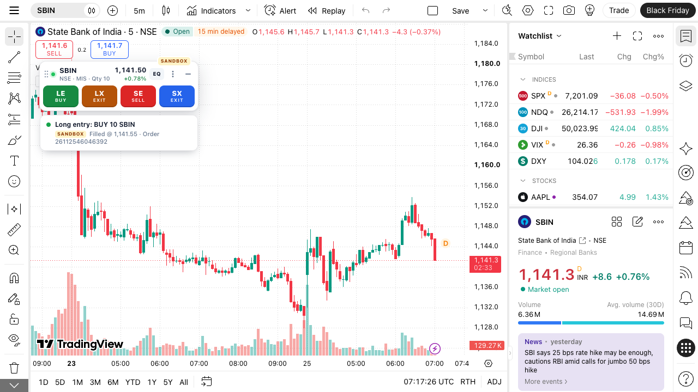
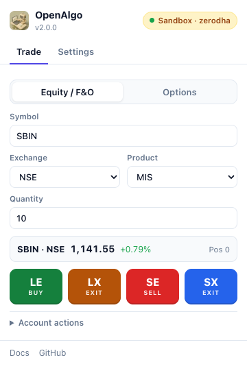

# OpenAlgo Chrome Extension

One-click trading buttons for your own [OpenAlgo](https://openalgo.in) server, on any website: TradingView, Chartink, broker terminals, news sites, anywhere.

## What's new in 2.0

- **Works on every website.** v1 showed `API Error: Failed to fetch` everywhere except the OpenAlgo dashboard, because orders were sent from the web page and blocked by CORS, mixed-content and Local Network Access rules. v2 sends every request from the extension's background service worker, so the page's security policy no longer matters.
- **Options entry and exit.** Buy or sell CE/PE at ATM, ITM1–10 or OTM1–10 with one click. The nearest expiry is picked automatically, or you can choose one. Exits close exactly the contracts you opened, even after the market has moved and ATM is a different strike.
- **Live data over WebSocket.** The bar shows the live price and day change of your symbol, and tells you when an order fills or is rejected.
- **Security hardened.** Your API key never touches the web page. Page scripts cannot click the buttons, read your settings, or trick you into clicking through an overlay. See [Security](#security).
- **New UI.** A cleaner floating bar that follows the page's light or dark theme. You can drag it, minimise it, or show it only on the sites you choose. The popup is now a full trading and settings panel.

## Install

1. Download `openalgo-chrome-v2.0.0.zip` from [Releases](https://github.com/marketcalls/openalgo-chrome/releases) and unzip it, or clone this repository.
2. Open `chrome://extensions` and switch on **Developer mode** (top right).
3. Click **Load unpacked** and select the unzipped folder.
4. The settings page opens automatically. Pin the OpenAlgo icon to your toolbar for quick access.

Upgrading from 1.x: your host URL, API key, symbol, exchange, product and quantity carry over. Your API key moves from Chrome Sync to this device only.

## Set up

1. Start your OpenAlgo server.
2. In the extension's **Settings** tab, enter the **Host URL** (default `http://127.0.0.1:5000`) and your **API key** (OpenAlgo → API Key).
3. Click **Test connection**. You should see something like `✓ Connected to zerodha · Sandbox`.
4. In the **Trade** tab, pick a mode and fill in the instrument.

The status pill at the top of the popup and the label on the floating bar always show whether you are in **SANDBOX** (OpenAlgo Analyzer mode, simulated orders) or **LIVE** (real orders).

## Trading

### Equity / futures mode

| Button | Action | API call |
|---|---|---|
| **LE** | Long entry: BUY *quantity* at market | `placeorder` |
| **LX** | Long exit: close the long position (does nothing if you are flat or short) | `openposition` → `placesmartorder` (position_size 0) |
| **SE** | Short entry: SELL *quantity* at market | `placeorder` |
| **SX** | Short exit: close the short position (does nothing if you are flat or long) | `openposition` → `placesmartorder` (position_size 0) |

### Options mode

Set the underlying (for example `NIFTY` on `NSE_INDEX`), expiry (or *Nearest expiry*), strike offset (ATM, ITM1–10, OTM1–10), side (buy or sell/write) and quantity in units. The popup shows the lot size, so `65` means one NIFTY lot.

| Button | Action |
|---|---|
| **CE BUY / SELL** | Places a call at the chosen offset via `optionsorder`; the resolved contract (e.g. `NIFTY01DEC2625900CE`) is remembered |
| **CE EXIT** | Closes every call contract opened from the extension via `placesmartorder` |
| **PE BUY / SELL** | Same for puts |
| **PE EXIT** | Closes every put contract opened from the extension |

Switch between the two modes with the **EQ / OPT** chip on the bar or the toggle in the popup.

### Floating bar

- **Drag** it by the header. The position is remembered and stays on screen when the window is resized.
- **–** minimises it to a small pill that still shows the live price. Click **OA** to expand it.
- **⋮** or the symbol opens settings.
- It stays usable over full-screen charts and page pop-ups.
- Settings → *Show on* lets you choose every website, only the sites you switch on, or nowhere (popup only). The *Show on this site* switch toggles the current site.

### Safety features

- **Confirm before sending orders** (optional): the first click arms the button (`SURE?`), and a second click within 3 seconds sends the order.
- While an order is in flight, the buttons are disabled, so a double click never sends two orders.
- If the server does not answer within 15 seconds, or reports that the broker reply was lost, you are told the order *may* have been placed and to check the order book. The order is never retried automatically.
- **Account actions** in the popup (*Close all positions*, *Cancel all orders*) also need a second click. They act on the whole account, as the OpenAlgo API does.

## Live data (WebSocket)

With *Live price & fill alerts* switched on, the extension connects to the OpenAlgo WebSocket proxy (default `ws://127.0.0.1:8765`, or `wss://<your-domain>/ws` for a remote HTTPS host; you can override this in Settings). It:

- subscribes to a Quote feed for the symbol, or for the underlying in options mode, and shows LTP and day change;
- subscribes to order updates and shows **Filled @ price** or **Rejected: reason** for orders placed from the extension only.

The connection opens only while a bar or the popup is visible, and closes 30 seconds after the last one goes away.

## Security

| Risk in v1 | v2 |
|---|---|
| The API key was written into an `<input>` in every web page's DOM, so any site could read it | The key is stored only in `chrome.storage.local`, restricted to the extension's own pages. The content script never receives it |
| Any web page could place orders with `document.getElementById('le-button').click()` | Buttons live in a **closed** shadow root on a plain `
` host (so a page cannot pre-register a custom element and open the root via `ElementInternals`). Synthetic (untrusted) events are ignored, and the content script can only ask for a fixed action name such as `LE` |
| Settings were built with `innerHTML` from stored values (HTML injection) | All UI is built with DOM APIs; no `innerHTML` |
| The API key was synced to the Google account via `chrome.storage.sync` | The key stays on this device; only non-secret preferences sync |
| Page CSS could hide or restyle the buttons; a page overlay could trick you into clicking | The bar uses `!important` inline styles and the browser's top layer, and raises itself above any pop-up the page opens. A click must start and end on the same button. If the page moves, restyles, hides or covers the bar, it is put back and clicks are refused for a second. A double-click never confirms an order |
| Network errors after an order was sent looked like plain failures, inviting a duplicate retry | Lost connections, timeouts, 5xx replies and proxy error pages on order calls say *"The order may have been placed. Check the order book before retrying."* |
| — | The popup warns when the API key would travel over plain `http://` to a non-local server |

**Privacy:** the extension talks only to the OpenAlgo server you configure. It collects no analytics and sends nothing anywhere else.

## Troubleshooting

| Message | Fix |
|---|---|
| `Cannot reach OpenAlgo at …` | Start the OpenAlgo server and check the host URL in Settings |
| `Invalid openalgo apikey` / HTTP 403 | Copy the API key again from OpenAlgo, and make sure you are logged in to your broker in OpenAlgo |
| `Setup needed` on the bar | Fill in the symbol and quantity (or underlying and quantity in options mode) |
| `No reply in 15s. The order may have been placed…` | Check the OpenAlgo order book before clicking again |
| `The page just moved or covered the OpenAlgo bar` | The site moved the bar or put something over it. Check that the bar is clear and click again. If it keeps happening, drag the bar elsewhere |
| Live price not showing | Check that the OpenAlgo WebSocket server is running (port 8765) and the WebSocket URL in Settings |
| Bar missing on a tab opened before installing | It is injected automatically on install/update; reload the tab if it is still missing |

## Development

No build step and no dependencies: the extension is plain JavaScript.

| File | Purpose |
|---|---|
| `manifest.json` | MV3 manifest |
| `shared.js` | Defaults and helpers shared by every context |
| `background.js` | Service worker: REST + WebSocket client, order logic, message router |
| `content.js` | Floating trading bar (closed shadow DOM) |
| `popup.html` / `popup.css` / `popup.js` | Popup and settings page (also used as the options page) |

`./package.sh` builds `dist/openalgo-chrome-v<version>.zip` for release or Chrome Web Store upload.

## Requirements

- Chrome 116 or later (or another Chromium-based browser)
- OpenAlgo server with an API key

## License

MIT. See [LICENSE](LICENSE).

Copyright (c) 2025 Marketcalls
